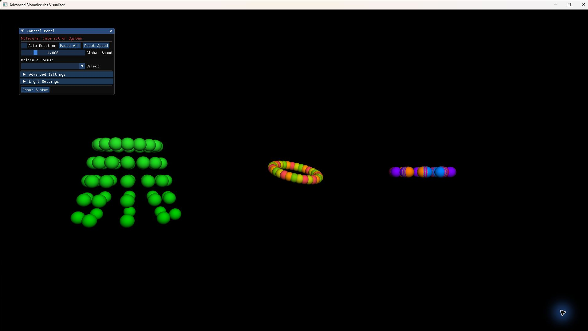

# DNA Visualizer

A small C++ desktop program for viewing stylised DNA, RNA, and protein structures in 3D. The scene can be rotated and adjusted through an ImGui control panel. The interaction modes illustrate proximity-based ideas such as hybridisation and binding.

## Project summary

The project is an educational graphics demonstration. Molecule geometry and interactions are generated by the application code; they are not a molecular-dynamics model and have not been validated against experimental data.

**Keywords:** molecular visualisation, OpenGL, C++, interactive graphics

## Application preview

This frame was captured from the running desktop application. The initial view keeps the DNA, RNA, and protein examples in frame, with automatic rotation available from the control panel.



## What the program shows

- A nucleotide helix for DNA, a wave-shaped RNA strand, and a simplified protein form
- Per-base colours and visual bonds between nearby components
- Interactive controls for rotation, simulation speed, molecule focus, and interaction modes

The current interaction rules use geometric distance thresholds. They are useful for showing a visual idea, but they do not model chemical energies, solvent, or experimentally measured structures.

## Build

### Requirements

- CMake 3.15 or later
- A C++17 compiler
- OpenGL, GLEW, FreeGLUT, and GLM development packages
- Dear ImGui, provided as a pinned Git submodule

On Debian or Ubuntu, the system packages can be installed with:

```bash
sudo apt update
sudo apt install build-essential cmake freeglut3-dev libglew-dev libglm-dev
```

Clone the repository with its submodules, or initialise them after cloning:

```bash
git clone --recurse-submodules https://github.com/ayoamooo/DNA_Visualizer-3D-modeling.git
cd DNA_Visualizer-3D-modeling
# If the repository was cloned without --recurse-submodules:
git submodule update --init --recursive
```

Then configure and build:

```bash
cmake -S . -B build
cmake --build build --config Release
./build/BioVisualizer
```

The CMake target compiles Dear ImGui and its GLUT/OpenGL backends from the pinned `imgui/` submodule. The `nanovg/` submodule is retained from the original project tree but is not used by the current target.

## Controls

- Drag with the left mouse button to orbit the scene.
- Use the control panel to start automatic rotation, change simulation speed, focus a molecule, and select an interaction mode.

## Academic scope

This program is a visual aid for exploring basic molecular shapes and simple distance-based interactions. It should not be used to infer molecular structure, binding affinity, transcription rates, or biological outcomes.

## References

- [OpenGL reference documentation](https://registry.khronos.org/OpenGL-Refpages/)
- [Dear ImGui](https://github.com/ocornut/imgui)
- [GLM](https://github.com/g-truc/glm)

## License

No project-level license is included. Third-party submodules keep their own licenses. Contact the author before reusing the project.
